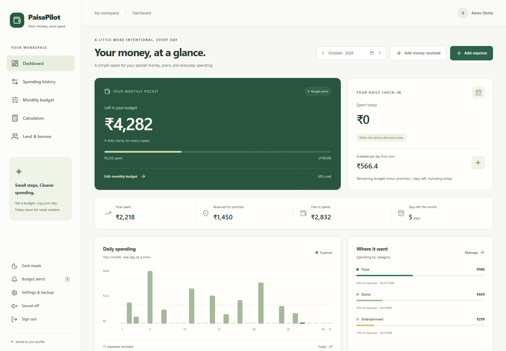
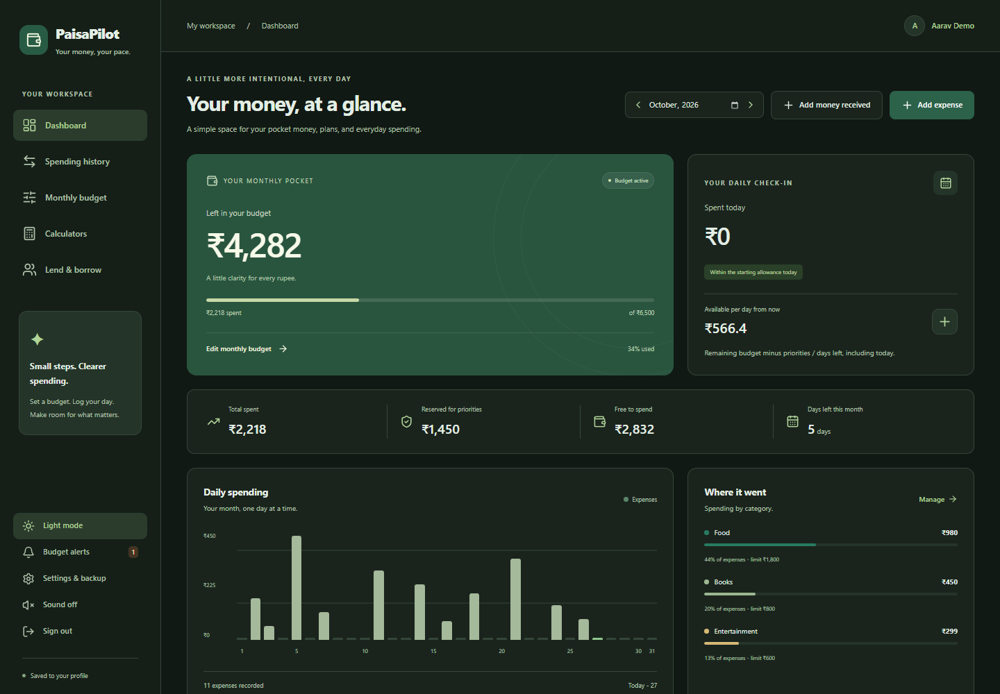
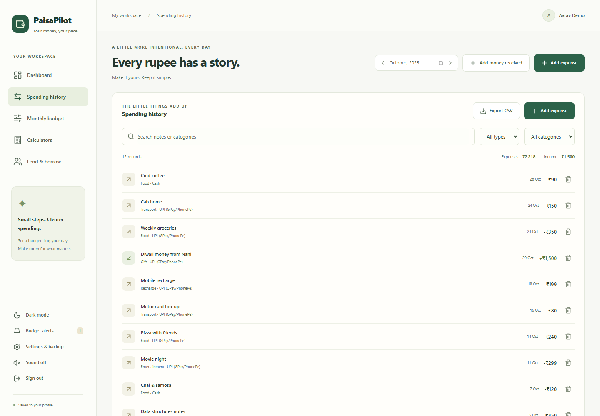
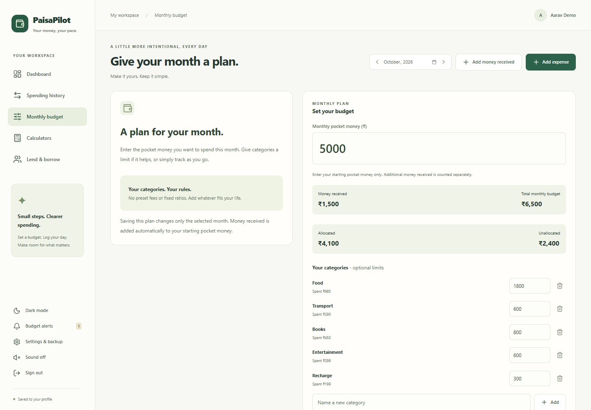
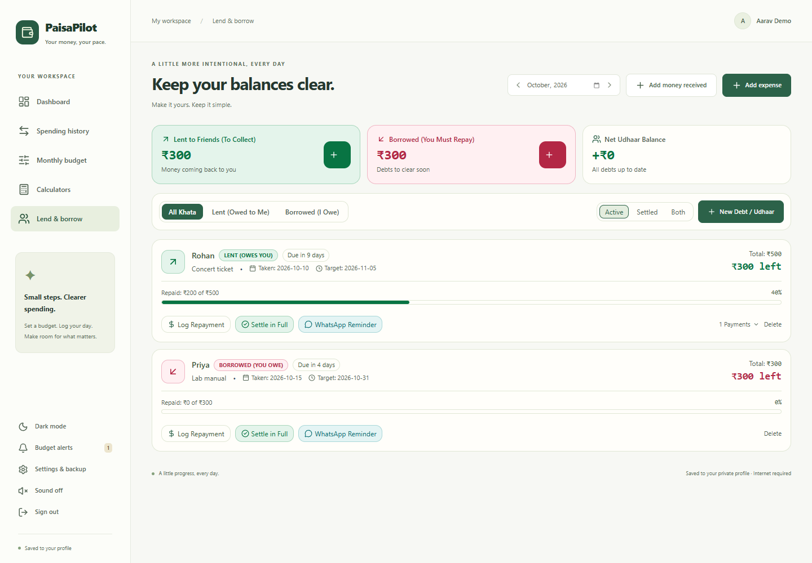
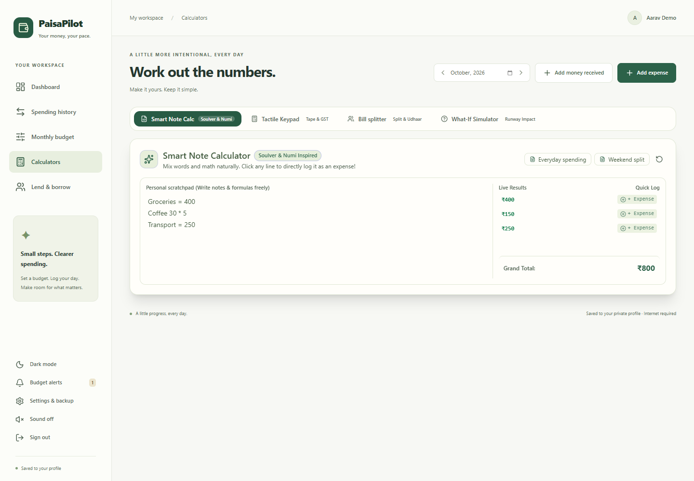
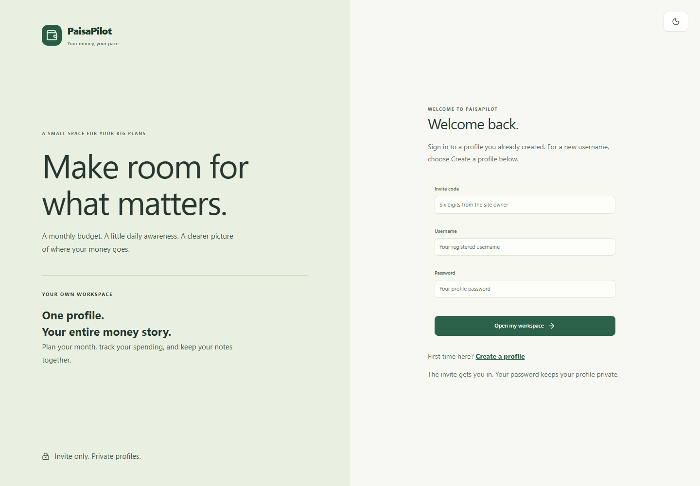
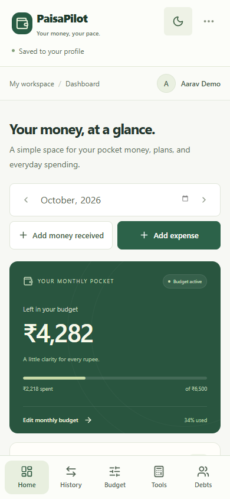
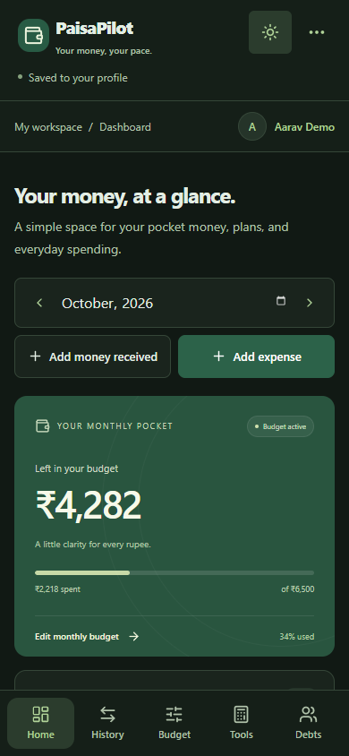
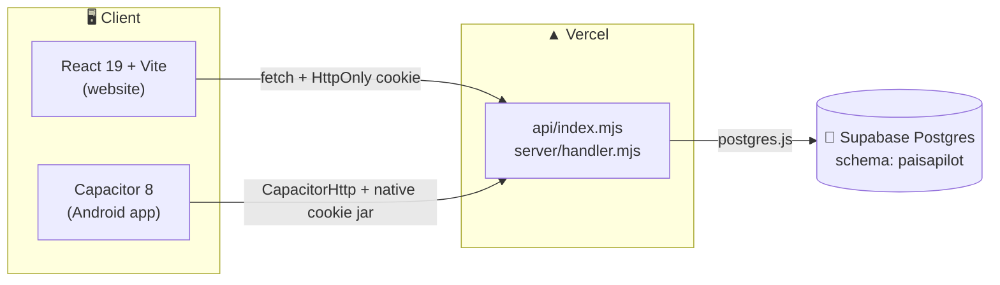

<div align="center">


# PaisaPilot

### Your money, your pace.

A calm, private, invite-only budget tracker for monthly pocket money —<br>
plan the month, log each day, and always know what you can still spend today.

[](https://react.dev)
[](https://www.typescriptlang.org)
[](https://vite.dev)
[](https://tailwindcss.com)
[](https://supabase.com)
[](https://vercel.com)
[](docs/ANDROID.md)
[](https://nodejs.org)

[**Live site**](https://paisa-pilot-umber.vercel.app/) · [Features](#-features) · [Quick start](#-quick-start) · [Android](#-android-app) · [Security](#-security--privacy) · [Docs](#-documentation)

<br>



</div>

---

## ✨ Why PaisaPilot?

> **One question, answered every day: _“How much can I spend today?”_**

| | |
|---|---|
| 🎯 **Daily allowance** | Your remaining budget, minus planned purchases, split across the days left in the month. |
| 🗂️ **Your own categories** | No preset fees or fixed ratios. Add whatever fits your life. |
| 📌 **Priorities that reserve money** | Plan an exam fee or a gadget; its money is set aside until you mark it paid. |
| 🤝 **Udhaar tracker** | Remember who owes you and whom you owe, with partial repayments and WhatsApp reminders. |
| 🔒 **Private by design** | Invite-only access, hashed passwords, per-profile data and no third-party trackers. |
| 📱 **Web + Android** | One account, same records, on the website and the Android app. |

---

## 🖼️ Features

<table>
<tr>
<td width="50%">

#### 📊 Dashboard
Money left, spent today, daily allowance, reserved priorities, a daily spending chart, category breakdown, notes and recent activity — for any month you pick.

</td>
<td width="50%">

#### 🧾 Spending history
Every expense and receipt in one ledger. Search, filter by type or category, and export to CSV (formula-safe for spreadsheets).

</td>
</tr>
<tr>
<td></td>
<td></td>
</tr>
<tr>
<td>

#### 🧮 Monthly budget
Set starting pocket money and optional limits per category. Money you receive later is added automatically.

</td>
<td>

#### 🤝 Lend & borrow
Track lent and borrowed money, log partial repayments, settle in full and see overdue reminders.

</td>
</tr>
<tr>
<td></td>
<td></td>
</tr>
<tr>
<td>

#### 🔢 Calculators
Smart note calculator (mix words and maths), tactile keypad with tape and GST, bill splitter and a what-if simulator. Arithmetic is parsed safely — never with `eval`.

</td>
<td>

#### 🔐 Invite-only sign-in
Everyone needs the owner's six-digit invite to register or sign in. The invite is checked on the server, never shipped to the browser.

</td>
</tr>
<tr>
<td></td>
<td></td>
</tr>
</table>

### 📱 Made for phones too

<div align="center">

&nbsp;&nbsp;&nbsp;

</div>

Bottom navigation within thumb reach, light and dark themes, and Android Back-button support.

> All screenshots use fictional demo data. Regenerate them with `npm run build && node scripts/capture-readme-images.mjs`.

---

## 🧠 How the money maths works

```text
Monthly budget   = starting pocket money + money received this month
Daily allowance  = max(0, remaining monthly budget − unpaid priorities) ÷ days left (including today)
```

- Enter your **starting** pocket money only in the budget. Record later money as **Add money received**.
- Removing a receipt reduces available funds automatically.
- Marking a priority **paid** creates its expense and releases the reservation.
- Budgets, priorities and notes belong to the month you select.
- Loans are tracked separately and do not change your budget.

---

## 🏗️ Architecture



- **One profile = one JSON snapshot** (`profiles.data`) with a `revision` counter. Saves send the last-known revision; a stale save gets `409` instead of overwriting another tab.
- **Autosave** runs 500 ms after your last change. If a save fails, your changes stay on screen and in exports.
- **Shared validation** in [`shared/finance.mjs`](shared/finance.mjs) runs on both client and server, so bad data is rejected before it is stored.

<details>
<summary><b>📁 Project structure</b></summary>

```text
.
├── api/index.mjs              # Vercel serverless entry
├── server/
│   ├── handler.mjs            # Routes: session, login, register, save, logout, delete
│   ├── auth.mjs               # scrypt passwords, tokens, HMAC, config checks
│   ├── store.mjs              # Postgres store
│   └── schema.sql             # Tables: profiles, sessions, auth_limits
├── shared/finance.mjs         # Snapshot validation, backups, CSV escaping
├── src/
│   ├── Workspace.tsx          # Session, autosave, tab locking
│   ├── App.tsx                # Main app state and screens
│   ├── components/            # Overview, Transactions, Budget, Calculator, LendBorrow, …
│   └── utils/                 # Calculations, dates, arithmetic parser, theme, export
├── android/                   # Capacitor Android project
├── scripts/                   # Tests, DB setup, Android build, README screenshots
└── docs/                      # Deployment, Android and feature guides
```

</details>

---

## 🚀 Quick start

**Requirements:** Node.js **24** and a Supabase Postgres database.

**1. Install dependencies**

```bash
npm ci --ignore-scripts
```

**2. Configure environment** — copy `.env.example` to `.env.local` and fill in:

| Variable | What it is |
|---|---|
| `DATABASE_URL` | Supabase **Transaction pooler** URI (port `6543`) |
| `INVITE_CODE` | Your private six-digit invite |
| `SESSION_SECRET` | Random string, at least 32 characters |
| `APP_ORIGIN` | Exact site address, e.g. `http://localhost:5173` |

> [!WARNING]
> These are server-only secrets. Never prefix them with `VITE_`, and never commit `.env.local`.

**3. Create the database tables**

```bash
npm run db:setup
```

Or paste [`server/schema.sql`](server/schema.sql) into Supabase's SQL editor.

**4. Run it**

```bash
npm run dev
```

Open the exact `APP_ORIGIN` address. Missing configuration fails closed: the app will not start without a database.

### ▲ Deploy to Vercel

Set the same four variables in your Vercel project, then deploy. The full checklist is in the [deployment guide](docs/deployment.md).

---

## 🤖 Android app

The Android app bundles the same React frontend with Capacitor and signs in to the same profiles as the website.

```bash
npm run android:build
```

This needs **Java 21** and **Android SDK 36**, and produces `artifacts/PaisaPilot-debug.apk`. Setup, install steps and limitations: [docs/ANDROID.md](docs/ANDROID.md).

---

## 🛡️ Security & privacy

- 🎟️ **Invite-only** — the six-digit invite is required for every sign-in and registration. Changing it signs everyone out.
- 🔑 **Passwords** hashed with scrypt. Sessions use `HttpOnly`, `SameSite=Strict` cookies; only token hashes are stored.
- 🧱 **CSRF tokens** and strict `Origin` checks on every change.
- 🐢 **Rate limits** per IP, per username and globally.
- 👤 **Profile isolation** — the profile always comes from the session, never from the request.
- 🧹 **Strict Content-Security-Policy**, no Google Fonts and no analytics.
- 💾 **Backups** — export and restore your own JSON. Unknown fields and legacy keys are stripped.

---

## 🧪 Scripts & checks

| Command | What it does |
|---|---|
| `npm run dev` | Start the dev server with the API |
| `npm run build` | Type-check and build to `dist/` |
| `npm test` | Finance, profile and mobile unit tests |
| `npm run test:browser` | Playwright + axe accessibility tests (dummy data) |
| `npm run test:database` | Tests against a live database |
| `npm run lint` | Lint with oxlint |
| `npm run db:setup` | Create the database schema |
| `npm run android:build` | Build the debug APK |

Tests cover invite enforcement, profile isolation, CSRF, session revocation, throttling, revision conflicts, backup validation, CSV neutralisation, arithmetic parsing, failed-save exports and accessibility.

---

## 📚 Documentation

| Guide | Covers |
|---|---|
| [Deployment](docs/deployment.md) | Secrets, Vercel, Supabase, profile security, limitations |
| [Android](docs/ANDROID.md) | Building, installing and testing the APK |
| [Pre-deployment checks](docs/predeployment-checks.md) | What to verify before sharing the site |
| [Calculators](docs/CALCULATORS_GUIDE.md) · [Udhaar tracker](docs/UDHAAR_TRACKER.md) | Feature guides |

> [!NOTE]
> Some older guides under `docs/` (for example `ARCHITECTURE.md` and `DATA_MODELS.md`) describe an earlier, browser-only version. This README and the deployment guide describe the current product.

<div align="center">
<br>
<sub>Made with 💚 for students who want a little more clarity for every rupee.</sub>
</div>
