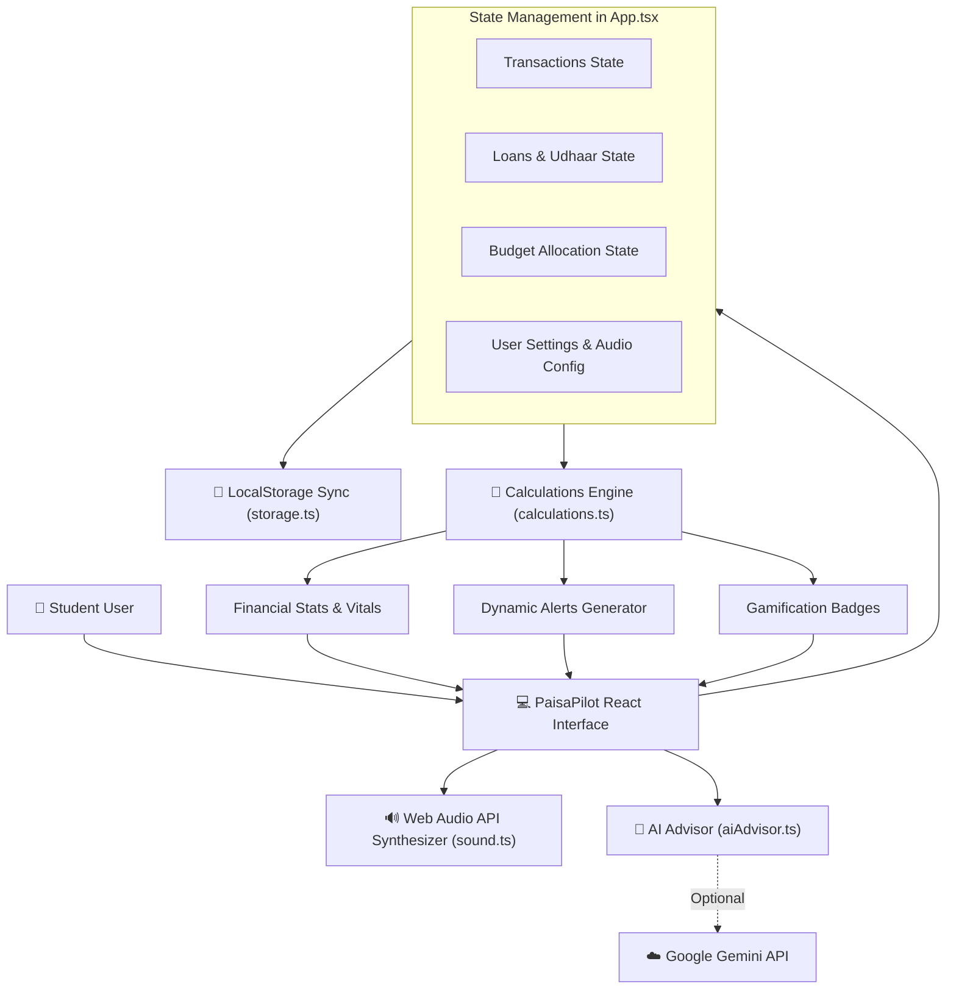

# 🏛️ Architecture Guide — PaisaPilot OS

## 1. High-Level Architecture

PaisaPilot is built with a **reactive, unidirectional data flow** architecture. The application is completely offline-capable, storing all records in browser `localStorage` and calculating financial insights in real-time.



---

## 2. Directory Layout

```
Project - 2/
├── docs/                       # Complete Markdown documentation
│   ├── README.md               # Documentation directory
│   ├── ARCHITECTURE.md         # System architecture & data flow
│   ├── CALCULATORS_GUIDE.md    # Guide to the 4 fancy calculators
│   ├── UDHAAR_TRACKER.md       # Borrow & Lend tracker guide
│   ├── AI_COACH_GUIDE.md       # AI advisor & prompt guide
│   ├── DATA_MODELS.md          # Schemas, types, and LocalStorage layout
│   └── STUDENT_PLAYBOOK.md     # Student budgeting strategy guide
├── graphify/                   # Graphify architecture knowledge graph
│   ├── graph.html              # Interactive visual graph viewer
│   ├── graph.json              # Raw graph nodes & edges
│   └── GRAPH_REPORT.md         # Graph topology report
├── src/
│   ├── components/
│   │   ├── AI/                 # AI Coach Modal & quick prompts
│   │   ├── Alerts/             # Notification center drawer
│   │   ├── Budget/             # 60/25/15 Budget allocator
│   │   ├── Calculator/         # Smart Note, Tactile, Splitter, What-If
│   │   ├── LendBorrow/         # Udhaar tracker, repayment modals
│   │   ├── Transactions/       # Ledger, filters, export, modals
│   │   ├── Navbar.tsx          # App header & navigation
│   │   └── Overview.tsx        # Dashboard hero, radar, and badges
│   ├── types/
│   │   └── finance.ts          # Core TypeScript domain models
│   ├── utils/
│   │   ├── aiAdvisor.ts        # Local heuristics + Gemini client
│   │   ├── calculations.ts     # Pure financial math calculations
│   │   ├── sound.ts            # Web Audio API sound synthesizers
│   │   └── storage.ts          # Persistence & demo data
│   ├── App.tsx                 # Root coordinator
│   ├── index.css               # Tailwind CSS & theme tokens
│   └── main.tsx                # React root mount
└── README.md                   # Project overview & quick start
```

---

## 3. The Pure Math Kernel (`src/utils/calculations.ts`)

To guarantee sub-millisecond updates without sluggish UI lags, calculations are separated into a pure mathematical kernel:

### Formula 1: Daily Safe Spending Limit
$$\text{Safe Limit} = \max\left(0, \left\lfloor \frac{\min(\text{Remaining Budget}, \text{Current Balance})}{\text{Days Remaining in Month}} \right\rfloor\right)$$

### Formula 2: Daily Burn Rate
$$\text{Burn Rate} = \left\lfloor \frac{\text{Total Month Expenses}}{\max(1, \text{Days Passed in Month})} \right\rfloor$$

### Formula 3: Projected Runway
$$\text{Projected Runway (Days)} = \begin{cases} \left\lfloor \frac{\text{Current Balance}}{\text{Burn Rate}} \right\rfloor & \text{if Burn Rate} > 0 \\ \text{Days Remaining} & \text{otherwise} \end{cases}$$

---

## 4. Web Audio Synthesizer (`src/utils/sound.ts`)

Instead of downloading slow MP3/WAV assets that can fail to load or buffer, PaisaPilot uses the browser's native **Web Audio API**:
- **Tactile Click**: High-frequency sine wave dropping to 300Hz in 40ms.
- **Calculator Pop**: Soft triangle wave pulse at 620Hz in 50ms.
- **Coin Chime**: Dual harmonic chords (987Hz and 1318Hz) with exponential decays.
- **Victory Chime**: 4-note ascending chord progression (C5 $\to$ E5 $\to$ G5 $\to$ C6).
- **Mute Safety**: Controlled by a single global boolean `sound.enabled` saved in preferences.

